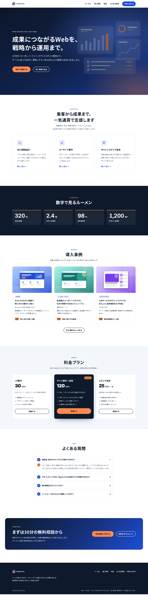
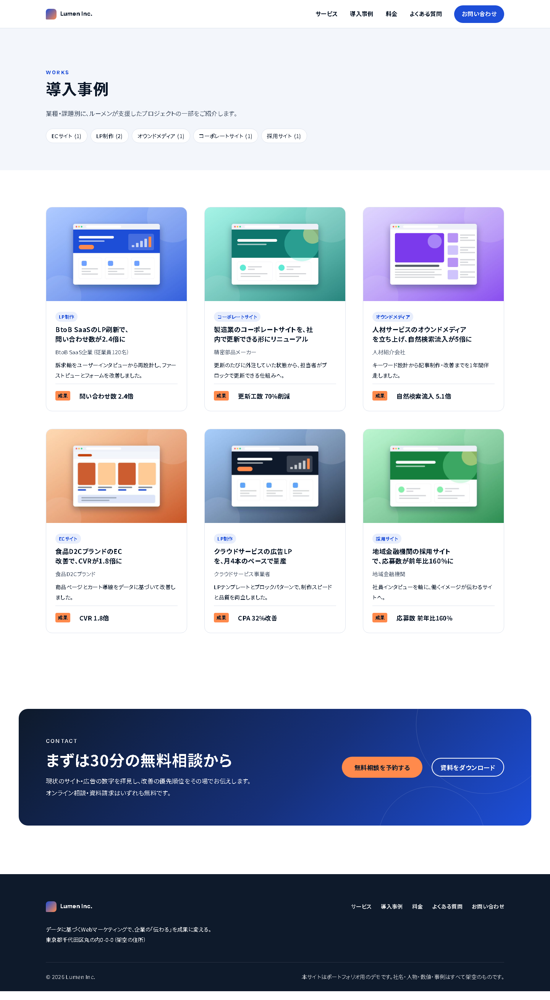
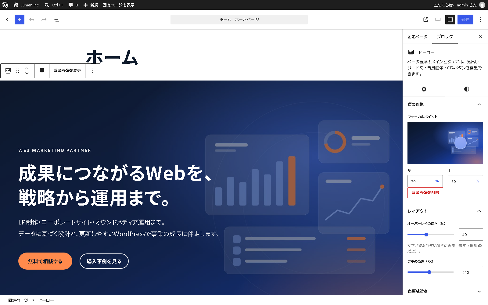
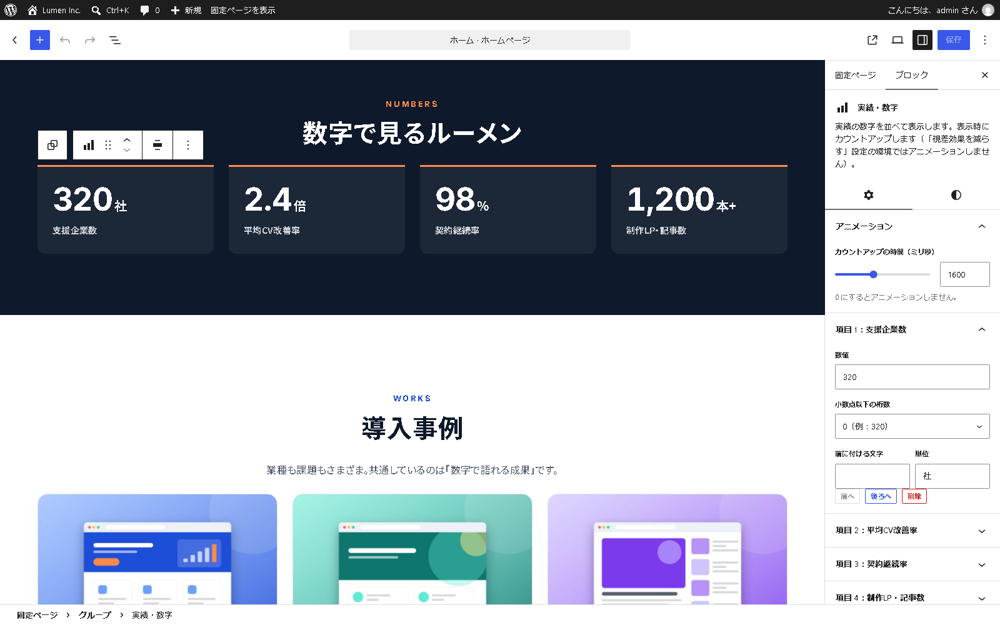
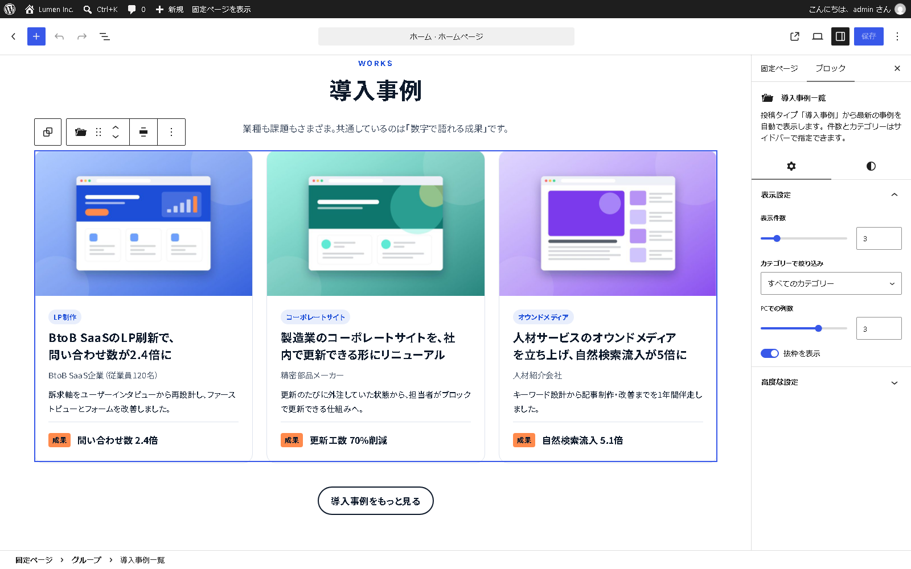
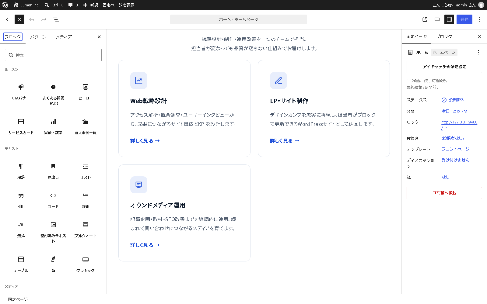

# Lumen — WordPress カスタムブロック＋ブロックテーマ（React）デモ

[](https://github.com/minatofullstack-ops/wp-react-blocks-demo/actions/workflows/ci.yml)

架空のWebマーケティング会社「ルーメン株式会社（Lumen Inc.）」のコーポレートサイト／LPを題材にした、**WordPress 内で完結する React 開発（Gutenberg カスタムブロック＋ブロックテーマ）** のポートフォリオ用デモです。ヘッドレス構成や Next.js は使っていません。

> 社名・人物・数値・事例・料金はすべて架空です。実在の企業・ブランドとは関係ありません。

**▶ ブラウザで試す（インストール不要・WordPress Playground）**

- サイトを見る: <https://playground.wordpress.net/?blueprint-url=https://raw.githubusercontent.com/minatofullstack-ops/wp-react-blocks-demo/main/playground/blueprint.json>
- ブロックエディターを開く: <https://playground.wordpress.net/?blueprint-url=https://raw.githubusercontent.com/minatofullstack-ops/wp-react-blocks-demo/main/playground/blueprint-editor.json>

（管理画面には自動ログインします。変更はブラウザ内だけで完結し、どこにも保存されません。）



---

## このデモで示していること

| ご要望 | このリポジトリでの対応 |
| --- | --- |
| WordPress 内で完結する React | すべてのブロックの編集 UI を React（`@wordpress/block-editor` / `@wordpress/components`）で実装。フロントの動きは Interactivity API |
| Gutenberg カスタムブロック／ブロックテーマ | プラグイン `lumen-blocks`（8ブロック）＋ブロックテーマ `lumen`（theme.json v3・テンプレート・パターン） |
| @wordpress/scripts | ビルド・Lint・テスト・ZIP をすべて `wp-scripts` ベースの npm scripts で実行 |
| デザインカンプの忠実な再現 | 色・文字サイズ・余白・レイアウト幅を theme.json のデザイントークンに集約し、ブロック側は CSS 変数だけを参照 |
| レスポンシブ | PC 1440px／スマートフォン 390px で確認（横スクロールなし）。流体タイポグラフィ・流体スペーシング |
| 非エンジニアでも編集できる形 | 日本語 UI のサイドバー設定、ブランドカラー以外の色・任意の文字サイズを無効化、パターンで「セクションごと挿入」、`contentOnly` ロックで料金表のレイアウトを保護 |
| ACF 歓迎 | 本デモは ACF を使わず、`register_post_meta` ＋ React のサイドバーパネル＋ Block Bindings で同等のことを実装（下記参照）。ACF Blocks／ACF フィールドでの実装にも対応可能です |
| テンプレートを複数ページ展開 | ページ用パターン「LPテンプレート」から別の LP（`/lp-owned-media/`）を量産するサンプル。導入事例は投稿タイプ＋テンプレート＋動的ブロックで何件でも展開 |
| Git（GitHub） | 機能単位のコミット、GitHub Actions で Lint・テスト・ビルド、タグ push でテーマ／プラグイン ZIP をリリース |

## 構成

```
.
├── plugins/lumen-blocks/        # ブロック・投稿タイプ（コンテンツ側）
│   ├── lumen-blocks.php
│   ├── includes/                # CPT・ブロック登録・エディター用アセット・WP-CLI デモ投入
│   ├── src/
│   │   ├── blocks/<name>/       # block.json / edit.js / save.js / render.php / view.js / *.scss
│   │   ├── editor/works-meta.js # 「導入事例の情報」サイドバーパネル
│   │   └── utils/               # 純粋関数＋ユニットテスト
│   ├── demo/images/             # デモ用画像（自作の抽象イラスト）
│   └── build/                   # ← npm run build の出力（Git 管理外）
├── themes/lumen/                # ブロックテーマ（見た目側）
│   ├── theme.json               # デザイントークン
│   ├── templates/  parts/  patterns/
│   └── assets/                  # セルフホストのフォント・CSS・画像
├── playground/                  # WordPress Playground の blueprint
├── scripts/make-zips.mjs        # 配布用 ZIP 作成
└── .github/workflows/           # CI / Release
```

### なぜ「テーマ＋プラグイン」に分けたか

- **テーマは見た目、プラグインはコンテンツの構造**という役割分担です。ブロックや投稿タイプをテーマに入れると、将来テーマを差し替えたときに既存ページのブロックが「サポートされていないブロック」になり、導入事例のデータにもアクセスできなくなります。
- ブロックのスタイルはテーマのデザイントークン（`--wp--preset--*` の CSS 変数）を参照し、未定義のときはフォールバック値を持つため、テーマを変えても崩れません。
- 1リポジトリ（モノレポ）で管理し、ビルド設定・Lint 設定・CI を共通化しています。

### `build/` をコミットしない理由

ビルド成果物はソースと二重管理になり、差分レビューのノイズにもなるため Git 管理外にしています。配布物は GitHub Actions がタグ push 時にビルドして **Release に ZIP を添付**します（`lumen-blocks.zip` / `lumen.zip`）。本番サーバーへはこの ZIP をアップロードすれば Node.js 不要で動作します。WordPress.org のように「リポジトリ＝配布物」の運用が必要な案件では、`build/` をコミットするか配布用ブランチを分ける運用に切り替えます。

## ブロック一覧

| ブロック | 種類 | ポイント |
| --- | --- | --- |
| ヒーロー `lumen/hero` | 静的 | RichText・MediaUpload（MediaReplaceFlow / MediaPlaceholder）・FocalPointPicker・InnerBlocks（`core/buttons`、`templateLock: insert`）。色はブロックサポート（パレット限定）。**deprecation の実例あり** |
| サービスカード `lumen/service-cards` ＋ `lumen/service-card` | 静的（親子） | 親は `allowedBlocks`・`template`・`orientation`、子は `parent` 指定。アイコンは固定セットから選択、リンクは BlockControls のポップオーバーで設定 |
| 実績・数字 `lumen/stats` | 動的＋Interactivity API | 数値は PHP で描画（SEO・スクリーンリーダー・JS 無効時も正しい値）。`viewScriptModule` で画面に入ったらカウントアップ。`prefers-reduced-motion` ではアニメーションしない |
| 導入事例一覧 `lumen/works` | 動的（render.php） | CPT「works」を WP_Query で取得。件数・カテゴリー（REST から取得）・列数・抜粋をサイドバーで指定。エディターは ServerSideRender でプレビュー |
| FAQ `lumen/faq` ＋ `lumen/faq-item` | 動的ラッパー＋静的 InnerBlocks | `<button aria-expanded aria-controls>`＋`role="region"`。↑↓／Home／End で質問間を移動。FAQPage の構造化データ（JSON-LD）を子ブロックから自動生成 |
| CTAバナー `lumen/cta` | 静的 | 背景色・グラデーションはブランドパレットのみ（ブロックサポート）。ボタンは `core/buttons` |

### 動的ブロックと静的ブロックの使い分け

- **動的（render.php）**: 他の投稿に依存する（導入事例一覧）、マークアップを今後変える可能性が高い（実績・数字、FAQ のアコーディオン部分）。保存されるのは属性だけなので、HTML を変えても既存ページが「ブロックの検証エラー」になりません。
- **静的（save.js）**: 編集者が書いた文章そのものが主役のブロック（ヒーロー、カード、CTA）。DB に HTML が残るためプラグイン停止時も表示が残り、表示も高速です。
- 静的ブロックの保存形式を変える場合は **deprecation** で移行します。`src/blocks/hero/deprecated.js` は「v1.0：背景画像を CSS の background-image で出力」→「v1.1：`` 要素に変更（LCP・遅延読み込み・フォーカルポイント対応）」の実例です。属性名の変更（`backgroundUrl` → `mediaUrl`）も `migrate` で移行します。デモの「ブロック移行デモ」ページ（`/block-migration-demo/`）は v1.0 形式で保存されており、エディターで開くとエラーなしで新形式に変換されます。

### 投稿タイプ「導入事例（works）」

- `register_post_type` / `register_taxonomy`（事例カテゴリー）/ `register_post_meta`（クライアント・成果・支援期間）をすべて `show_in_rest` で登録。
- メタは React の `PluginDocumentSettingPanel` で編集（`auth_callback` で権限チェック、`sanitize_text_field` でサニタイズ、保存は REST API＝nonce 付き）。
- テンプレート `single-works.html` / `archive-works.html` では **Block Bindings**（`core/post-meta`）でメタを表示。PHP を書かずにテンプレート側でカスタムフィールドを差し込めます。
- 新規作成時は「概要／課題／施策／成果」の雛形が入り、見出しは移動・削除できないようロックしています（本文は自由に編集可）。

### ACF を使う場合

ACF Pro の ACF Blocks（`block.json`＋PHP テンプレート）や ACF フィールドグループでも同じ構成は実現できます。本デモはプラグイン依存を減らし、フィールド定義もコードとして Git 管理できるよう、コアの API（post meta＋React パネル＋Block Bindings）で実装しています。既存サイトが ACF 前提の場合は ACF に合わせて実装します。

## テーマ（theme.json）

- パレットはブランドカラー8色＋グラデーション2種のみ。`custom: false`、`defaultPalette: false`、`customFontSize: false`、`customSpacingSize: false` で、編集者がブランドから外れた色・サイズを選べないようにしています。
- 文字サイズ・余白は `clamp()` による流体スケール。レイアウト幅は 760px / 1200px。
- フォントは Noto Sans JP（unicode-range で分割したセルフホスト）＋ Inter（`fontFace` で登録）。外部 CDN に依存しません。
- テンプレート: `front-page` / `page` / `page-wide`（全幅・タイトルなし）/ `single` / `single-works` / `archive-works` / `taxonomy-works_category` / `404` / `index`。テンプレートパーツ: ヘッダー（スマホではハンバーガーメニュー）/ フッター。
- パターン（「ルーメン：セクション」「ルーメン：ページ」カテゴリ）: ヒーロー、サービス紹介、実績・数字、導入事例、**料金表（`templateLock: "contentOnly"`）**、よくある質問、お問い合わせ導線、LPテンプレート（全セクション）。

## 編集者向けの使い方

1. 固定ページを新規作成すると「LPテンプレート（全セクション）」を選べます。選ぶとヒーロー〜CTA までが入るので、文言と画像を差し替えるだけで LP が完成します。
2. 途中にセクションを足したいときは、ブロック挿入ツールの「パターン」→「ルーメン：セクション」から選びます。
3. ブロック単体は挿入ツールの「ルーメン」カテゴリにまとまっています。設定は右サイドバー（日本語）で行います。
4. 料金表はレイアウトがロックされています。金額・文言・リンクは直接クリックして編集できます。
5. 導入事例は管理画面の「導入事例」から追加します。右サイドバーの「導入事例の情報」に成果などを入力すると、一覧カードや詳細ページに自動で反映されます。

## 開発

必要なもの: Node.js 20 以上（`.nvmrc` は 24）、npm。PHP の Lint を行う場合は PHP 8.x と Composer。

```bash
npm ci
npm run build        # plugins/lumen-blocks/build を生成
npm run start        # 監視ビルド
npm run lint:js      # ESLint（@wordpress/eslint-plugin）
npm run lint:css     # Stylelint（@wordpress/stylelint-config）
npm run format       # Prettier（@wordpress/prettier-config）
npm test             # ユニットテスト（wp-scripts test-unit-js / Vitest）
npm run zip          # dist/lumen-blocks.zip と dist/lumen.zip を作成
composer install && composer lint:php   # PHPCS（WordPress Coding Standards）
```

### ローカルで WordPress を動かす（Docker・MySQL 不要）

```bash
npm run build
npm run playground   # http://127.0.0.1:9400 （自動ログイン）
```

`@wp-playground/cli` がテーマとプラグインのフォルダをマウントし、`playground/blueprint.local.json` に従って日本語化・有効化・デモデータ投入（`wp lumen-demo import`）まで行います。`npm run start` と併用すると、保存のたびにビルドされた JS/CSS がそのまま反映されます。

### リリース

```bash
git tag v1.0.0 && git push origin v1.0.0
```

GitHub Actions（`release.yml`）がビルドし、Release に `lumen-blocks.zip` と `lumen.zip` を添付します。Playground の blueprint はこの最新 Release の ZIP をインストールします。

## スクリーンショット

| | |
| --- | --- |
| トップページ（スマートフォン 390px）<br> | 導入事例一覧（PC）<br> |
| エディター：ヒーロー（背景画像・フォーカルポイント・オーバーレイ）<br> | エディター：実績・数字（項目の追加・並べ替え）<br> |
| エディター：導入事例一覧（件数・カテゴリー）<br> | エディター：ブロック挿入ツールの「ルーメン」カテゴリ<br> |

その他: `docs/screenshots/` を参照してください。

---

## English summary

Portfolio demo of **WordPress-native React development**: a block theme (`themes/lumen`, theme.json v3 design tokens, templates, template parts, patterns incl. a `contentOnly`-locked pricing table) plus a plugin (`plugins/lumen-blocks`) with eight custom blocks built with `@wordpress/scripts` (block.json apiVersion 3): hero (static, with a real `deprecated.js` migration), service cards (parent/child InnerBlocks), stats (dynamic + Interactivity API count-up, respects `prefers-reduced-motion`), works list (dynamic `render.php` querying a `works` custom post type, ServerSideRender preview), accessible FAQ accordion (Interactivity API, keyboard support, FAQPage JSON-LD) and a CTA banner. Post meta is edited in a React sidebar panel and displayed via Block Bindings (no ACF needed). Theme = presentation, plugin = content structure, so content survives a theme switch. CI runs ESLint, Stylelint, Vitest unit tests, PHPCS (WPCS) and the build; tagging `v*` publishes theme/plugin ZIPs that the WordPress Playground blueprint installs, so the demo can be opened in the browser without installing anything. All company names, numbers and case studies are fictional.

## License

GPL-2.0-or-later. Fonts: Noto Sans JP / Inter（SIL Open Font License 1.1）。
